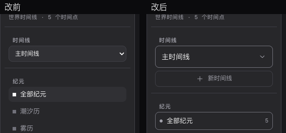
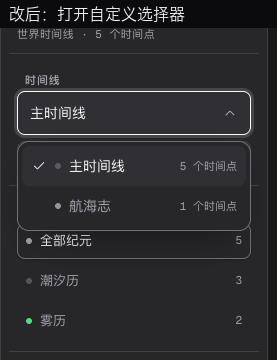
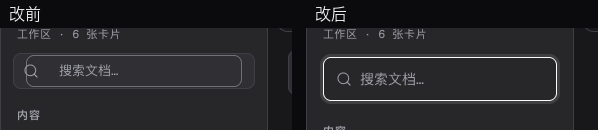
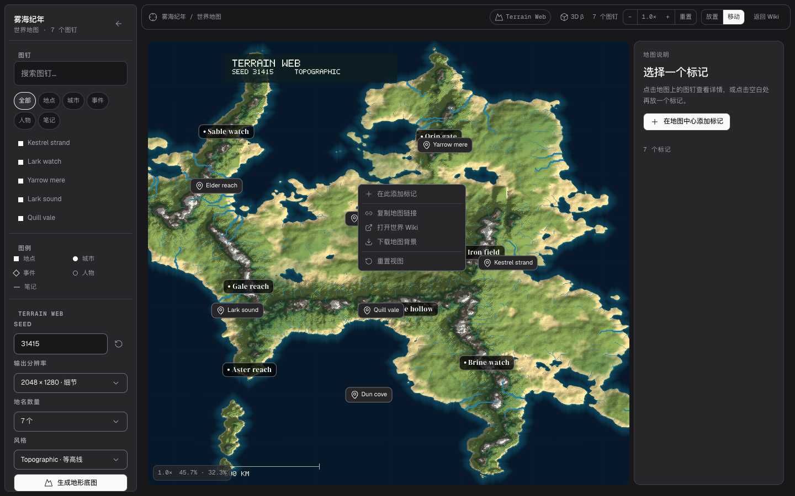
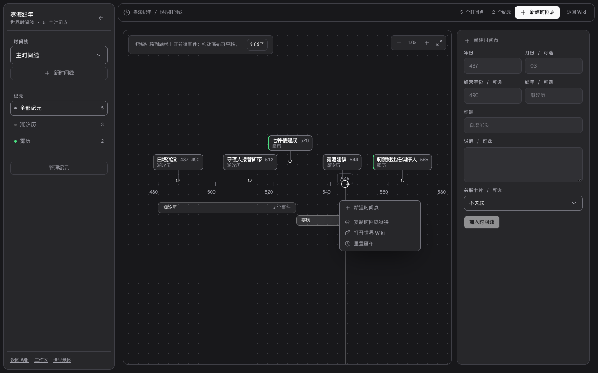
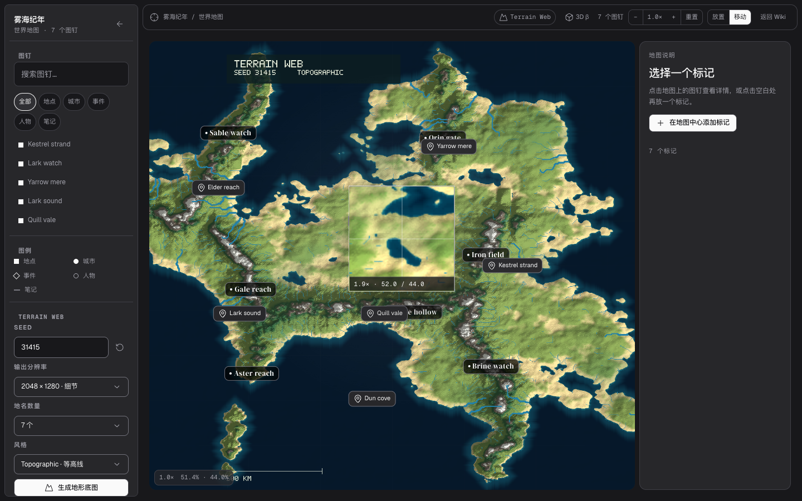
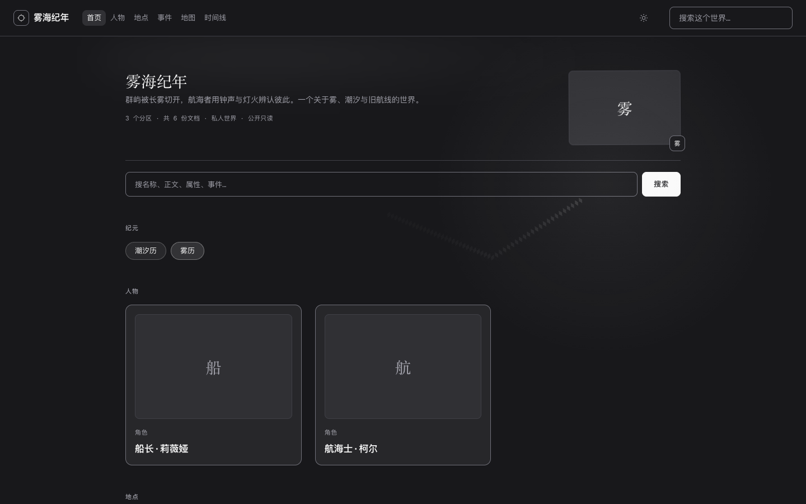

# R3–R6：控件、右键、动效与 Codrops 效果

你是对的。上一轮我主要做了 token、字体、间距和配色，**没有真正处理原生控件，也没有把交互动效做完**。你截图里的时间线下拉和搜索框就是证据：它们仍然是 OS/UA 默认控件，搜索框还是 wrapper + input 两层边框。这一轮没有再换一套颜色，而是补控件和动效。

## 1. 你截图的两处

### 1.1 时间线选择器

改前：原生 `<select class="studio-select">`，打开后是 macOS/Chrome 的系统菜单，只有灰底和默认 focus ring。

改后：新增 `SelectMenu`（`frontend/src/components/SelectMenu.tsx`）：
- 关闭态是 44px 的 token 化字段，chevron 在展开时旋转；
- 打开态是 `role="listbox"` 的浮层，带 `select-in` 160ms 入场、选中 check、选项 hint（“5 个时间点”）、纪元色点；
- 支持方向键/Home/End/Enter/Escape/Tab，点击外部关闭，焦点回到 trigger；
- 时间线切换器、纪元颜色、关联卡片、地图的 7 个选择器、成员角色/邀请/转移 4 个选择器全部替换，共 **14 个**。旧 `.studio-select` 只在这条时间线里使用，已不再出现。Topbar 的世界切换器保留原生，但在工作区 CSS 里本来就 `display:none`。

打开态：

### 1.2 工作区搜索

改前：`.search` wrapper 有 `1px` 边框，内部 `input` 又有 `1px` 边框；32/36px 高，聚焦时外层再叠一层 ring，所以看起来像两层框。

改后：
- 只有 wrapper 一条边框；input `border:0; background:transparent`；
- 高度 44px，图标与文字基线对齐；
- 聚焦用 `:focus-within` 的 3px 低透明度 ring，不再有 input 自己的 focus 边框；
- 地图的 `.map-pin-search` 也从 28px 改成 44px；地图类型筛选从 24px 小胶囊改成 32px 可点按钮。

## 2. 其余控件也没放过

- **原生 checkbox**：`appearance:none` + 16px token 化方框 + 选中对勾；支持 `:focus-visible`。
- **range**：4px 轨道 + 16px thumb，浅/深主题都可见；Terrain 3D 的方位角/仰角/高度滑杆现在有统一外观。
- **file input**：`::file-selector-button` 样式化；隐藏 input 的触发按钮保持原有逻辑。
- **按钮/图标按钮/菜单项**：hover 背景与边框、`:active` 的 1px 下沉/0.985 缩放，统一 160ms；`prefers-reduced-motion` 下全部关闭。
- **主题切换**：两个图标从 `display:none` 改成绝对定位 + opacity/rotate 过渡，切换时不再瞬切。
- **对话框/菜单**：`dialog[open]` / `.dialog-panel` / `[role=dialog]` 200ms 入场；自定义 select 160ms。
- **导航**：公开站 nav 链接有下划线生长动画；工作区 topbar 恢复了“世界 / 文档 / 世界名”面包屑（之前被 CSS 隐藏，左侧一片空）。

## 3. 右键菜单：应用内容能做，浏览器 chrome 不能

你截图的是 **Chrome 自己的右键菜单**（返回/重新加载/存储为/翻译/检查），它不是网页 DOM，网站无法改它的样式；强行在全局 `preventDefault` 只会让用户失去返回、重新加载、保存图片、翻译和检查。正确做法是：只在“应用有自己动作”的内容上换自定义菜单，浏览器能力留在浏览器。

这轮补了两处：

- **地图画布**（你截图的位置）：右键菜单变为“在此添加标记 / 复制地图链接 / 打开世界 Wiki / 下载地图背景 / 重置视图”。只读地图也能用，不再弹原生菜单。
- **时间线画布空白处**：右键菜单为“新建时间点 / 复制时间线链接 / 打开世界 Wiki / 重置画布”。
- 已有的工作区卡片树、编辑器、地图标记、时间线事件右键菜单继续复用同一个 `ContextMenu`（键盘导航、Escape、点击外部关闭、视口夹取）。

**仍然保留浏览器菜单的地方**：公共文章正文、输入框/文本选中区、浏览器自身 chrome。这些位置的复制选中文字、翻译、检查元素、自动填充是浏览器能力，不应用自定义菜单覆盖。

## 4. 动效层：页面级 + 环境级

**如果你在 5174 仍然完全看不到动效，先打开 `http://127.0.0.1:5174/?motion=force`。** 这个 query 会绕过 `prefers-reduced-motion`，但仍使用同一套 CSS。若 force 有动效、普通地址没有，说明是系统“减少动态效果”；若 force 也完全静止，说明构建/浏览器问题，不是“动画没写”。

R3 的动效主要是 hover/菜单/220ms 页面过渡，用户仍然觉得“干”。R5 补的是**进入页面就能看到**的运动：

- 页面内容 `enter-rise`：0.7s，16px 上浮，hero 标题/描述/操作/卡片按 0/70/140/210/280ms 错峰；首页、Explore、Wiki、Auth、Workspace 都有。
- Hero 环境光：14% 前景色径向光，10s 漂移；封面 5s 上下漂浮。
- 指针光：480px 径向光跟随鼠标；滚动进度 2px 顶部条。
- 跨文档 root 220ms → **280ms**；cover old/new 240ms；保留 `plus-lighter`。
- 所有动效在 `prefers-reduced-motion: reduce` 下默认关闭；为了能验证“是不是系统设置把它关了”，支持显式覆盖：
  `http://127.0.0.1:5174/?motion=force`（生产地址同样加 query）。
- R5 还修了一个测试脆弱点：共享元素测试在入口动画还没结束时 hover/click，导致 cover 有时没命名；现在等动画完成并显式 hover 100ms。

## 5. 过渡细节（R3）

- 跨文档 root：140ms → **220ms**；cover/icon/avatar 容器 260ms、old/new 220ms，delay 0、linear；保留 UA 的 additive fade 和 `plus-lighter`。
- 页面进入（无 View Transitions API 的浏览器）：`html[data-motion="css"]` 下 280ms 的 `page-in`，不再硬切。
- 同文档工作区换卡：有 `startViewTransition` 时走原 transition；没有 API 时加 `vt-fallback`，editor head/body 220ms `content-in`，不再是瞬换。
- 跨文档 overlay 加了 `::view-transition { background-color: var(--background) }`，避免 UA 白底在深色页面里透出来（视频/截图采样本身不可靠，这一条是防御性修复，不拿视频当唯一证据）。
- 测试：`custom controls` 断言 44px、input 边框 0、菜单 `animation-name=select-in`、checkbox `appearance:none` 16×16、tile hover 后 transform 不是 none；`root and shared fades` 断言 root/cover 都是 220ms、delay 0；workspace 测试包裹 `document.startViewTransition`，断言 `__vtCalls > 0`。

## 6. Codrops 学习后的两个效果（R6）

看了三篇 Codrops：

- [Beyond the Circle: Custom-Shaped Cursor Trail](https://tympanus.net/codrops/2026/09/24/custom-shaped-cursor-trail/)：关键不是 WebGPU，而是“用一个形状函数往速度场里盖章”，以及按真实时间衰减。这里做成 2D canvas 的**菱形笔刷拖尾**：菱形按速度方向旋转，64 点上限，life 衰减，细指针才启用，输入框/编辑器内自动跳过。
- [Mouse-Following Square Lens](https://tympanus.net/codrops/2026/08/25/building-a-mouse-following-square-lens-effect-with-three-js-and-glsl/)：关键是把“grayscale 全图 + 彩色方孔 + 平滑跟随”拆开。这里没有引入 Three.js/GLSL，而是直接读取地图的实时 canvas/背景图，画一个 190px 的**方形放大镜**，1.9×、十字线、坐标/缩放读数，鼠标离开/右键/打开 3D 时隐藏。效果相同，预算不增加。
- [Shape-Aware ASCII Renderer](https://tympanus.net/codrops/2026/09/04/beyond-the-luminance-ramp-a-shape-aware-ascii-renderer-in-three-js/)：它的核心是六点 shape vector + 95 字形搜索 + 三 pass。没有把这个 GPU 管线硬塞进内容站：会额外引入 Three.js/渲染目标，且当前 workspace 只剩 2.8 kB 预算。这里只借用“不要按亮度选形状”的原则，未冒充完成 ASCII 效果。

**R6.1 修了你在 Retina 屏上看到的“只有左上角有图像”**：canvas backing store 是 380×380，但绘制用了 CSS 尺寸 190×190，结果只填了左上 190×190，另外三个象限是黑的。修复是给 2D context 设 `setTransform(dpr, 0, 0, dpr, 0, 0)`，并加了一个 `deviceScaleFactor: 2` 的回归测试，采样四个象限的 alpha——修复前会失败。

测试：`custom controls` 里实际移到地图中央断言 `.map-lens.is-on` 和 `1.9×`，再在首页移动鼠标，读取 trail canvas 的非透明像素数 > 0。

## 7. 剩余原生表面审计

| 表面 | 处理 |
|---|---|
| `<select>` 打开态 | 14 个可见选择器全部 `SelectMenu`；Topbar 世界切换器保留但工作区 `display:none` |
| 搜索框 | 单边框 44px；地图 44px |
| checkbox / range / file input | token 化外观 |
| 原生 focus ring | 全局 `:focus-visible` + 组件 ring |
| 原生滚动条 | `scrollbar-width/color` + WebKit 10px thumb |
| `
` 三角 | rich/tiptap toggle 自定义 ▸ |
| `<dialog>` backdrop | 半透明背景 + 2px blur |
| 右键菜单 | 地图/时间线/卡片树/编辑器/标记/事件自定义；文章正文保留浏览器 |
| 浏览器文件选择器 | 不能样式化，保留 OS；触发按钮已样式化 |
| 原生 title tooltip | 仍是浏览器 tooltip；未做全局替换（避免破坏可访问名称） |
| 原生校验气泡/自动填充 | 仍是浏览器行为；未做全局替换 |

## 8. 门禁与证据

- `60 passed / 1 skipped`（desktop / mobile / auth / webkit）。右键菜单、地图 lens、cursor trail 由 `custom controls` 实际打开/移动并断言；`retina map lens` 在 DPR 2 下断言 canvas 380×380 且四个象限都有像素；另有 `motion opt-in` 在 `reduce` 下验证 `?motion=force` 仍执行 0.7s 入场。
- `tsc --noEmit`、`build:all`、`check:budget` 通过：entry 77.9/120，workspace 172.2/175（净平），CSS 32.6/40。
- `make ui-check`：字面量 0/0/0/0；`make test` 2/2；`make compile`；`manage.py check` 0 issues。
- 截图变化：4 张已有基线（explore dark/light mobile、workspace light auth、map light auth）和 2 张新基线（timeline-sidebar、workspace-sidebar）。变化原因分别是 mobile nav 的 skip-link 定位修复、工作区面包屑/搜索框、地图搜索/选择器。没有为了“16/16 一致”删基线重建。
- 提交：`11fea6f`（R3，控件/动效，21 文件）、`fec5429`（R4，右键菜单，5 文件）、`8e28117`（R5，页面级动效，8 文件）、`fb7928b`（R6，cursor trail + map lens，7 文件）、`79da2a3`（R6.1，lens DPR 修复，2 文件）；backend/docs/scripts.ci 未 stage。

## 9. 仍然没做到的

1. **这不是整站重做**。Home/Explore/Wiki 仍是上一轮的单色编辑风，只补了控件和 hover；如果你要的是“每个页面都有强视觉主张”，需要另开一轮版式设计，不是这轮能诚实声称的。
2. **Topbar 的世界切换器**仍是原生 `<select>`，但在工作区被 `display:none`；如果它会在别的布局出现，要再替换。
3. **Safari/WebKit 只覆盖 fallback**：没有跨文档过渡视觉对比；同文档 fallback 有 CSS 动画，但跨文档旧页面退出仍取决于浏览器。
4. **没有把动效录成可信视频**：Playwright 的 video/screenshot 在过渡窗口会采到白帧，不能作为视觉证据；我用 computed style 和事件测试，不拿白帧当结论。页面入场/指针光/滚动条可以用 `?motion=force` 直接看。
5. **浏览器右键菜单/文件选择器/自动填充/校验气泡/title tooltip** 只能由浏览器/OS 绘制，不能诚实地说“美化完了”；应用内容的右键已接，浏览器 chrome 保留。
6. **R6 的 lens 是 2D canvas 放大，不是 Three.js/GLSL 的 RGB shift/桶形畸变**；cursor trail 是 2D 菱形笔刷，不是 WebGPU 形状场。视觉效果做了，但不冒充文章里的 GPU 实现。
6. **320px 触控**只遍历 `a/button/input/select/[role=button]`，排除正文内联链接；checkbox/range 的 16px 可点区域靠 label，不是独立 44px。

如果你继续觉得“只是颜色变了”，最可能的是我还没动**页面级版式**（Home 的 hero、Explore 的网格、Wiki 的阅读栏）。控件层这轮已经补齐；版式层是否要再开一轮，由你决定。
