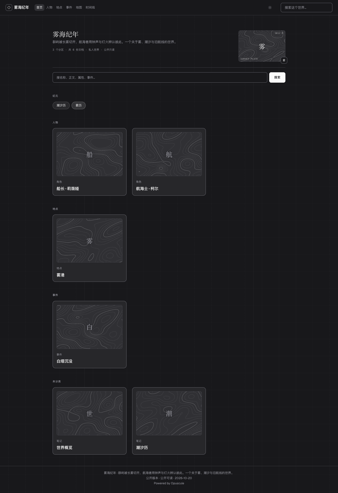
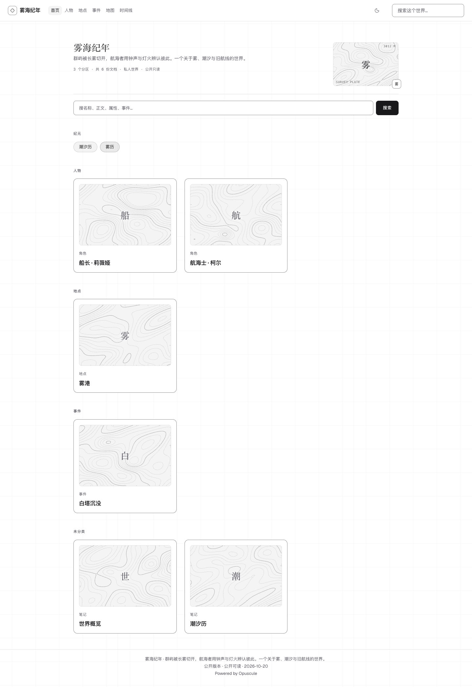
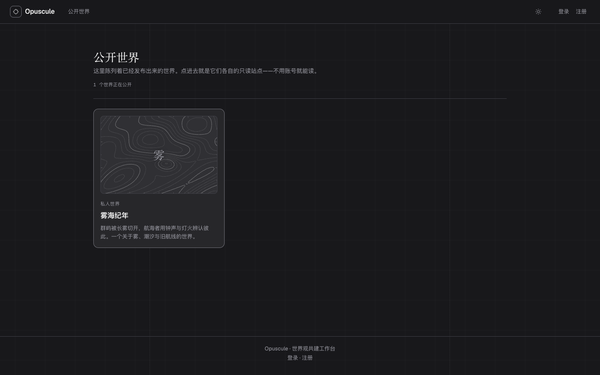
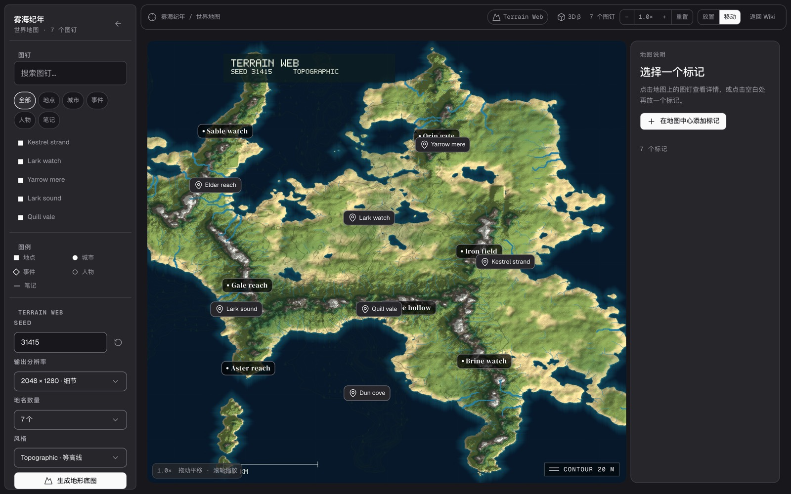

# R7：从 Ridgeline 学到的测量语言

参考：

- Codrops：[Building Ridgeline: Engineering a Real-Time 3D Experience in Webflow](https://tympanus.net/codrops/2026/07/22/building-ridgeline-engineering-a-real-time-3d-experience-in-webflow/)
- Site：[topography.webflow.io](https://topography.webflow.io/)

## 先说不做什么

Ridgeline 是 Three.js + R3F + drei + GSAP ScrollTrigger + Lenis 的实时 DEM 地形：真实高程、真实轨迹、三幕场景、滚动驱动、音频、持久 WebGL context。Opuscule 是内容/编辑产品，不是徒步摄影站。直接搬 Three.js 会：

- 与 workspace 172.2/175 kB 的预算冲突；
- 让公开页承担一个 3D 渲染器；
- 把“读世界”变成“等 WebGL”；
- 对没有真实 DEM 的虚构世界没有数据意义。

所以这轮取的是它的**测量语言**，不是它的 3D 管线。

## 1. 公共页的 survey grid

公共页 `.site-page` 现在有：

- 72px 细网格；
- 25% / 75% 两条主测线；
- 深色 3%、主测线 5.5% 的前景色，低于文字对比度；
- 700px 以下关闭，避免手机阅读被网格干扰。

它让空白区域从“没画完”变成“测量底图”，并且不抢标题和正文。

## 2. 空封面的 ContourPlate

`ContourPlate` 是一个确定性的 2D 地形版画：

- 用 world name / card slug 做 seed；
- 三层正弦山脊 + 三个高斯丘，生成 heightfield；
- 66×42 网格上跑 marching squares；
- 14 条等高线，每 5 条一条 major line；
- 中心用 destination-out 径向擦除，保证原来的单字仍然可读；
- 画 survey ticks、中心十字、`SURVEY PLATE` 和高度标签；
- hero 封面指针移动时，等高线最多偏移 5px（`prefers-reduced-motion` 或 coarse pointer 下不做）；
- 主题切换用 MutationObserver 重绘；
- 封面有真实图片时完全不画。

它是装饰性的虚构测量图，不是真实高程数据；`3012 M` 是 seed 生成的面板标签，不应被读成地理事实。

## 3. 地图等高线：修了一个真 bug

地图原本就有一段 marching-squares 等高线代码，但一直没有正确显示。根因不是透明度：

> 后端 `heightmap` 是 **PNG**（512×320，红通道高程），前端 `decodeHeightmap` 只做了 base64 → bytes，然后按 RGB 原始字节采样。它拿到的是 PNG 文件头/压缩数据，不是高程。

所以之前的“等高线”即使画了也是噪声/空。R7 做了：

- 用 `Image` + data URL 异步解码 PNG；
- 得到真正的 `ImageData`，按 RGBA 的 R 通道采样；
- 解码前不画，解码后重绘；`data-contours="ready"` 作为可测状态；
- 地图 1.0× 也显示等高线（stride 2，避免低倍率每帧做全量 marching squares）；
- 1.25× 以上 stride 1；
- 每 5 条 major line，线宽/透明度分层；
- 新增 `CONTOUR 20 M` 测量徽章。

这比“再加一个动画”更接近 Ridgeline 的核心：**真实地形数据被正确读出来，并成为页面的视觉主语。**

## 4. 性能与降级

- 没有新增依赖；
- 等高线 PNG 只解码一次，ImageData 存 ref；
- 低倍率 stride 2；高倍率才 stride 1；
- 封面等高线只在空封面画，真实封面色块不动；
- 所有 canvas 都是 `aria-hidden`，原文字仍在 DOM；
- `prefers-reduced-motion` 下不做指针视差，但静态等高线保留；
- 手机隐藏 survey grid，封面不依赖 hover。

## 5. 证据

- `60 passed / 1 skipped`（desktop / mobile / auth / webkit）。
- `custom controls` 现在额外断言：
  - `.map-canvas-surface[data-contours="ready"]`；
  - `.site-hero-cover canvas.contour-cover` 存在且非透明像素 > 0。
- 公共页 16 张截图基线、SSR wiki 基线已更新（R7 视觉是 intentional）。
- `tsc --noEmit`、`build:all`、`check:budget`：entry 77.9/120，workspace 172.2/175，CSS 32.9/40。
- 提交：`2f77dbc`。

## 6. 还没做

1. 真实 3D DEM 场景（Ridgeline 的 mesh/relief）——会引入 Three.js 和新的资产/预算决策。
2. GSAP ScrollTrigger / Lenis 的整页滚动叙事——当前内容页不需要。
3. 音频、preloader、letterbox 入场——会让内容站变慢；Ridgeline 用它们是因为它是电影式目的地。
4. ASCII 95-glyph shape search 仍未做；上一轮已说明预算原因。

如果要继续往 Ridgeline 靠，我建议下一步是 **地图 3D 预览的等高线/剖切面**，而不是给首页塞一个无数据的假 3D。
