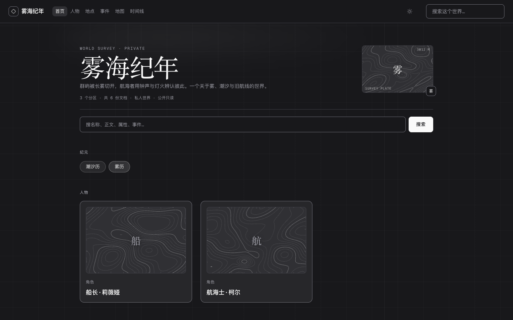
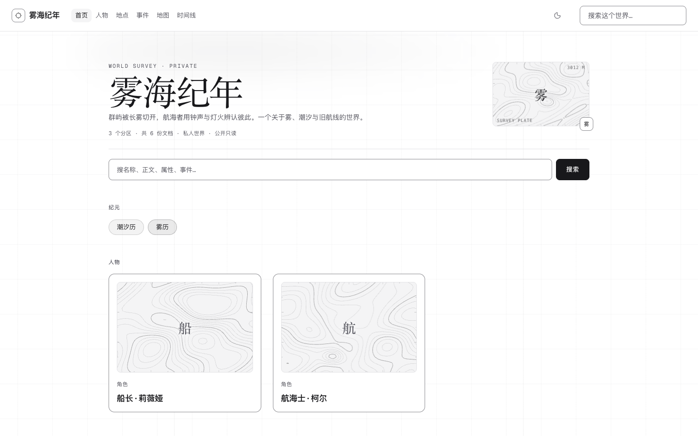
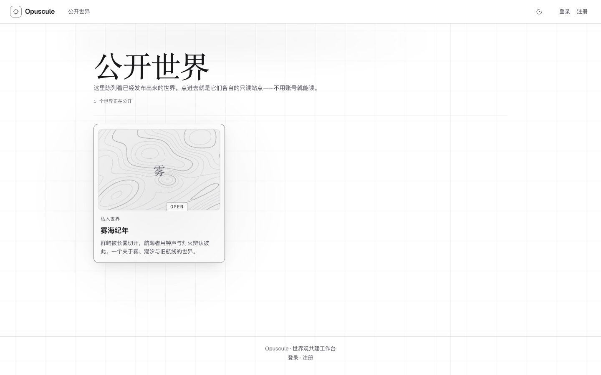
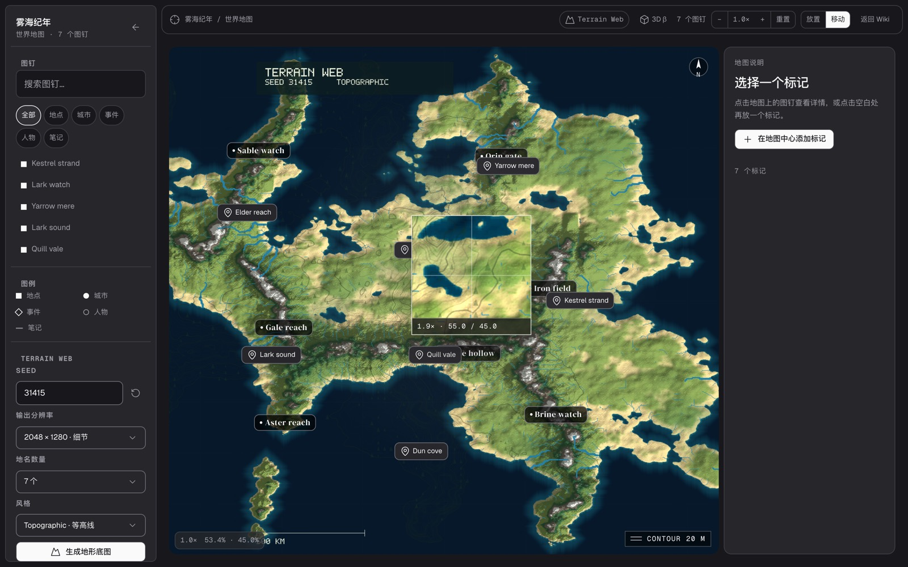

# R8：继续拆 Ridgeline

参考：

- Codrops：[Building Ridgeline](https://tympanus.net/codrops/2026/07/22/building-ridgeline-engineering-a-real-time-3d-experience-in-webflow/)
- Site：[topography.webflow.io](https://topography.webflow.io/)

R7 取了 survey grid 和等高线。R8 继续往下看，发现它不只是“地形很酷”，而是一整套**测量叙事**。

## 本轮真正拆到的

1. **入场 gate**：3D 地形 preloader、进度、声音开关、letterbox、`Enter without sound`。不是普通 loading。
2. **Atlas 首页**：整屏黑色测量网格、坐标、中心橙点、巨大无衬线标题、右侧 scene index 卡。
3. **滚动叙事**：大段引文随滚动出现；某个词用橙色高亮；字重/位置随滚动改变。
4. **Photo strip**：中间大图、两侧缩略图、固定 HUD、黑色等高线边框，像一卷被钉住的胶片。
5. **浮起的低多边形地形块**：等高线底图上叠低多边形山体、`ELEV / GRADE / BRC` 标签、橙色节点。
6. **Atlas route**：SVG 等高线地图、橙色路线、`No. 01` 地名、海拔/经纬度。
7. **Scene 页**：3D 地形全屏、左/上/右三边 metadata、极简固定 HUD。
8. **Menu overlay**：右侧大号 INDEX、TRAILS/SOCIAL/CONTACT 分组、等高线底纹、custom cursor。
9. **Custom cursor**：不是圆点，是带 `VIEW / DRAG / CLOSE` 状态的自定义指针。
10. **转场**：opaque cover 下完成页面替换，最后 reveal；不是白屏跳转。

## 这轮落地的

### 1. 超大 survey 标题

公共世界首页和 page head 从正文级标题改成展示级：

- `--text-display: clamp(48px, 5vw, 76px)`
- `--text-page-title: clamp(38px, 3.8vw, 56px)`
- 世界首页新增 `WORLD SURVEY · PRIVATE/OPEN` overline
- 手机仍回落到 32px，不把标题塞爆

### 2. Cursor 状态，而不只是拖尾

保留 native cursor，不劫持；在它旁边出现一个 mono 状态标签：

- world/card tile：`OPEN`
- timeline canvas：`DRAG` / `SCROLL`
- article 链接：`READ`
- fine pointer + 非 reduce 才启用；输入框/编辑器内自动隐藏
- 标签固定偏移 18px，并在视口边缘 clamp

### 3. 地图 compass

地图右上角加了 N 罗盘，和 R7 的 `CONTOUR 20 M`、等高线、方形 lens 一起组成测量 HUD。

## 没有照搬的

- **Preloader / 声音**：内容站不需要强制 gate；会增加等待，且站点没有声音内容。
- **滚动引文 / photo strip**：Ridgeline 是叙事型目的地，Opuscule 是 wiki/工作台；把正文改造成电影滚动会伤阅读。
- **浮起 3D 地形块**：需要 Three.js + 真实 mesh；没有 DEM 的虚构世界只能造假数据。R7 已明确不做假 3D。
- **Menu overlay**：当前 top nav 已覆盖导航；再加一个大 overlay 是重复入口。
- **Flood transition**：Chromium 下已有 cross-document View Transition；再叠一个 JS veil 会和它打架。Safari/Firefox 的 fallback 仍是现方案。

## 证据

- `60 passed / 1 skipped`（desktop / mobile / auth / webkit）。
- `custom controls` 断言：
  - timeline `DRAG` cursor label；
  - explore tile `OPEN` cursor label；
  - map `CONTOUR` / compass / `data-contours="ready"`；
  - hero `WORLD SURVEY` overline；
  - contour plate 非透明像素。
- entry 78.2/120，workspace 172.2/175，CSS 33.2/40。
- 公共页 16 张截图基线 + SSR wiki + map light 基线已更新。
- 提交：`ae60e86`。

## 下一步

如果继续往“电影感”走，真正缺的是 **3D 地形场景**，不是再加 hover。建议单独做一个 lazy 的 `Atlas3D`：真实 map heightmap → Three.js mesh → contour/scan plane → 只在 map 的 3D 预览入口加载。那会是一次明确的预算/依赖决策，不应混在 R8 的视觉层里。
